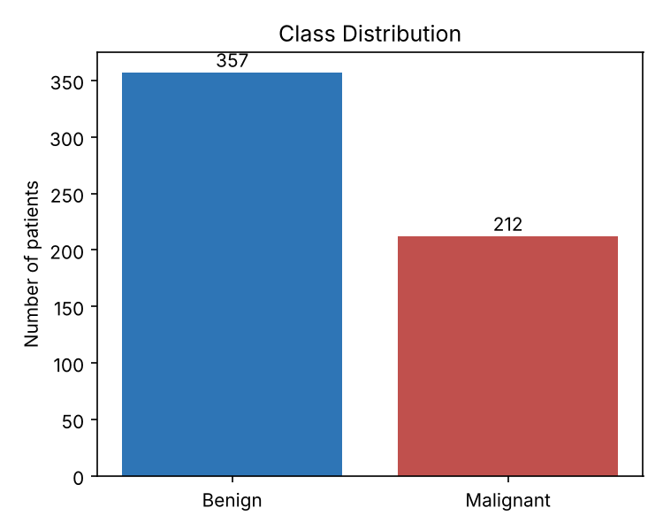
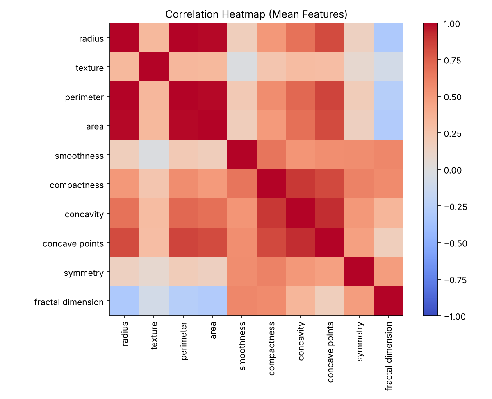
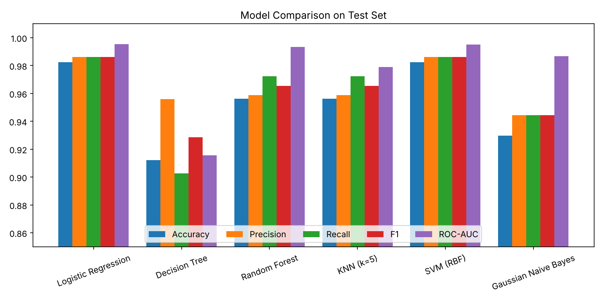
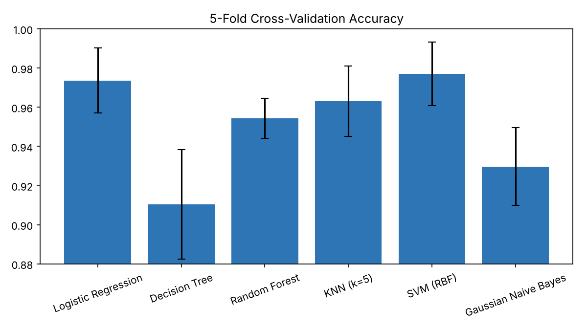
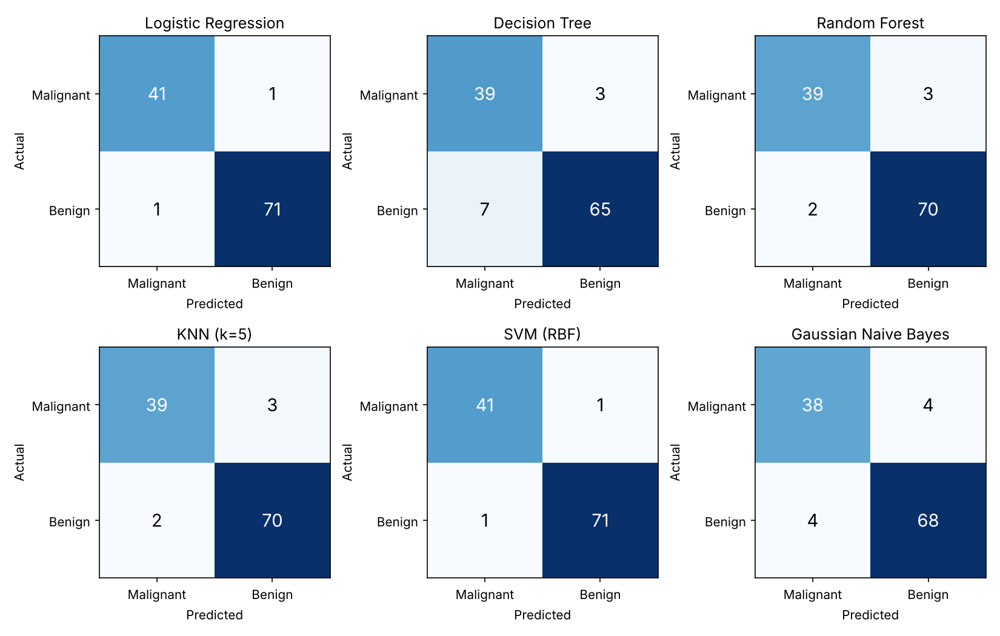
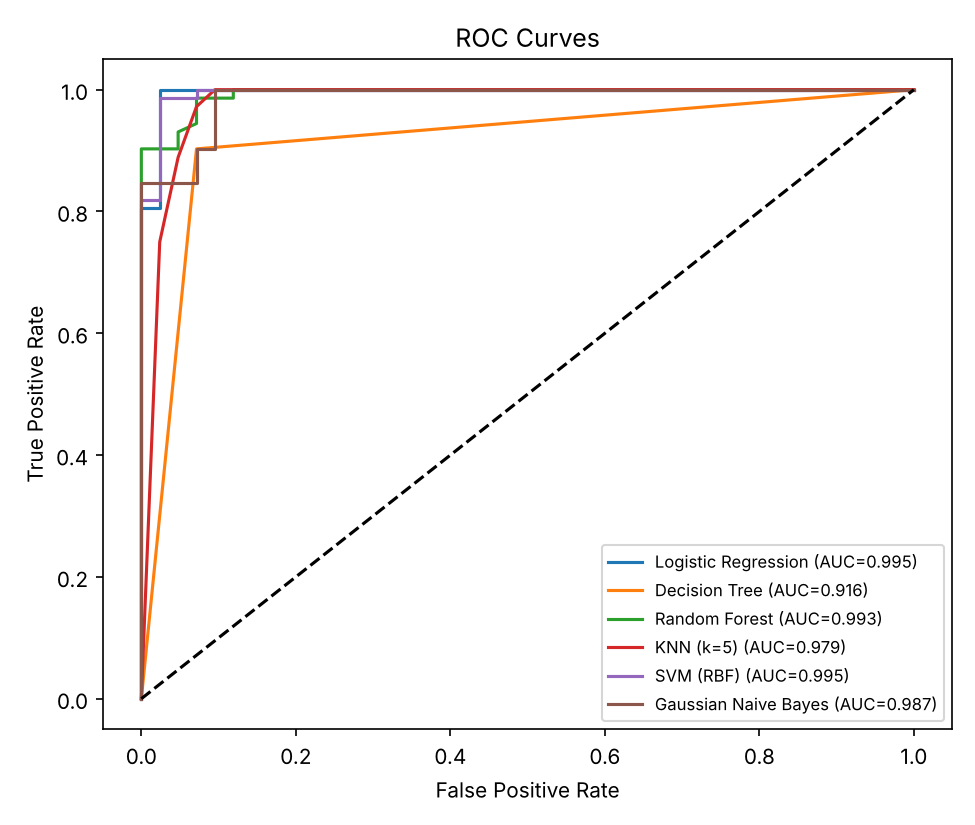
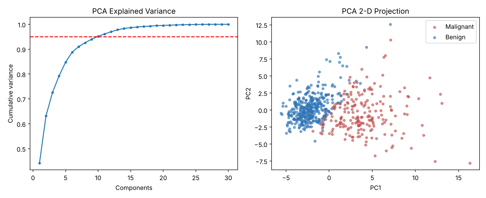
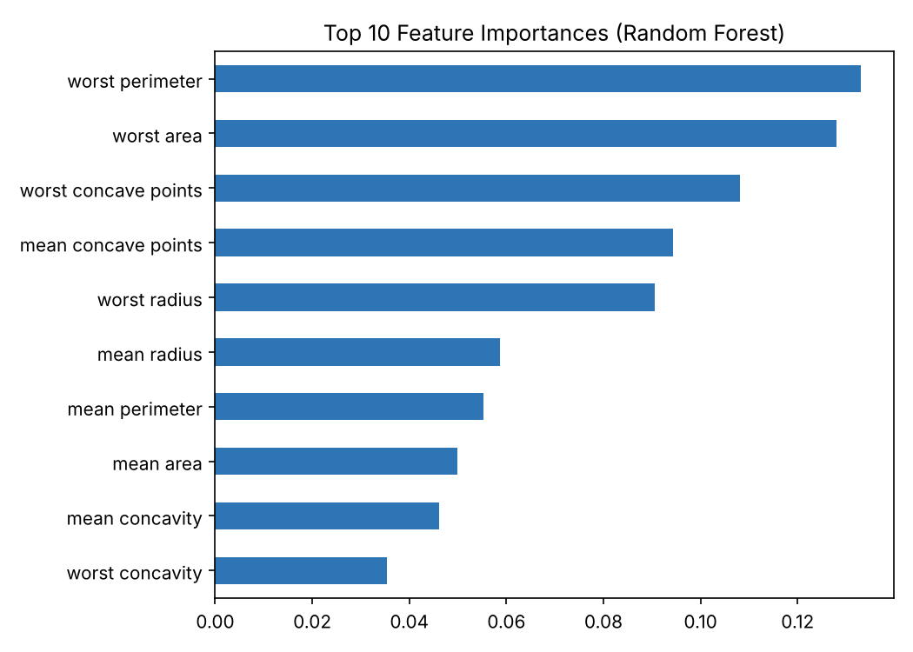
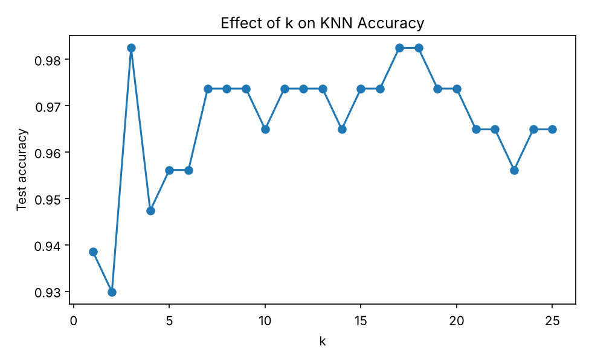
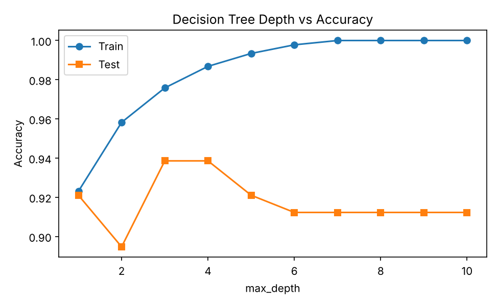

# Breast Cancer Diagnosis Prediction Using Machine Learning
### Comparative Evaluation of Six Supervised Classification Models on the Wisconsin Diagnostic Dataset

[](https://www.python.org/)
[](https://scikit-learn.org/)
[]()
[-navy.svg)](https://mnr.edu.in/)

---

## 👨‍🎓 Academic Information

| Item | Details |
|---|---|
| **Project Title** | Breast Cancer Diagnosis Prediction Using Machine Learning |
| **Course** | Machine Learning (Course Code: `25CSA201`) |
| **Degree & Branch** | B.Tech (Hons.) Computer Science and Engineering (Artificial Intelligence & Data Science) |
| **Institution** | School of Engineering, Technology & Artificial Intelligence, MNR University |
| **Student Name** | **Swasthika Battcharya** |
| **Roll Number** | **25RBAID0002** |
| **Project Guide** | **Dr. M. Praveen**, Department of CSE |
| **Academic Year** | 2025–2026 |

---

## 📌 Problem Description & Project Overview

### 1. What Problem Does This Project Solve?
Breast cancer is among the most commonly diagnosed malignancies worldwide and a leading cause of cancer mortality among women. The clinical prognosis and five-year survival rate increase dramatically when malignant tumors are identified at an early stage. Diagnostic evaluation frequently relies on **Fine Needle Aspirate (FNA)** biopsy samples, from which digitized cytological images are analyzed to quantify cellular characteristics (such as radius, texture, concavity, and symmetry).

Manual pathological inspection is subjective, time-intensive, and susceptible to inter-observer variability. In oncology, **False Negatives** (misdiagnosing a malignant tumor as benign) can have fatal consequences by delaying life-saving medical interventions.

### 2. Proposed Machine Learning Solution
This project establishes an automated, end-to-end Machine Learning pipeline that classifies breast masses as **Malignant** (harmful/cancerous) or **Benign** (non-cancerous) based on 30 quantitative morphological features extracted from cell nuclei. 

Key technical highlights include:
- Benchmarking **six supervised machine learning classifiers** under identical stratified train/test conditions.
- Mitigating feature scale disparity through **StandardScaler** z-score normalization.
- Ensuring clinical reliability through **ROC-AUC analysis**, **confusion matrices**, and **Stratified 5-Fold Cross-Validation**.
- **Hyperparameter optimization** for Support Vector Machines via exhaustive **GridSearchCV**.
- Diagnostic exploratory studies including **Principal Component Analysis (PCA)**, **Random Forest Feature Importance**, **KNN neighborhood ($k$) sensitivity**, and **Decision Tree pruning diagnostics**.
- Providing patient-level inference with **class probability calibration**.

---

## 📊 Dataset Description

The project utilizes the classic **Breast Cancer Wisconsin (Diagnostic)** dataset from the UCI Machine Learning Repository:

- **Source / UCI Link:** [UCI Machine Learning Repository – Breast Cancer Wisconsin (Diagnostic)](https://archive.ics.uci.edu/dataset/17/breast+cancer+wisconsin+diagnostic)
- **Local File Path:** [`dataset/breast_cancer_wisconsin_diagnostic.csv`](dataset/breast_cancer_wisconsin_diagnostic.csv)
- **Total Records:** 569 patient biopsy samples
- **Missing Values:** 0 (clean dataset with no null/NaN entries)
- **Target Variable (`diagnosis` / `target`):**
  - **Benign (`1`):** 357 cases (62.74%)
  - **Malignant (`0`):** 212 cases (37.26%)
- **Feature Space (30 continuous numerical predictors):**
  Ten fundamental nuclear morphological properties evaluated across three metrics (**Mean**, **Standard Error (SE)**, and **Worst / Largest**):
  1. *Radius* (mean of distances from center to perimeter points)
  2. *Texture* (standard deviation of gray-scale values)
  3. *Perimeter*
  4. *Area*
  5. *Smoothness* (local variation in radius lengths)
  6. *Compactness* ($\text{perimeter}^2 / \text{area} - 1.0$)
  7. *Concavity* (severity of concave portions of the contour)
  8. *Concave Points* (number of concave portions of the contour)
  9. *Symmetry*
  10. *Fractal Dimension* ("coastline approximation" - 1)

<p align="center">
  
  
</p>

---

## 🤖 Algorithms & Machine Learning Models Used

Six diverse supervised classification paradigms were implemented, trained, and comparatively evaluated:

1. **Logistic Regression (L2 Regularized):** Models the log-odds of malignancy using maximum likelihood estimation. Provides strong baseline probabilistic calibration.
2. **Decision Tree Classifier (CART):** Constructs orthogonal recursive splits based on Gini impurity. Evaluated across depths $1 \dots 10$ to examine underfitting and overfitting.
3. **Random Forest Classifier:** Ensemble of 100 decorrelated decision trees employing bootstrap aggregation (bagging) and random feature subspace sampling.
4. **K-Nearest Neighbors (KNN):** Non-parametric instance-based algorithm utilizing Euclidean distance metrics across standardized dimensions.
5. **Support Vector Machine (SVM):** Constructs optimal maximum-margin separating hyperplanes. Evaluated with both Radial Basis Function (RBF) and Linear kernels.
6. **Gaussian Naive Bayes (GNB):** Probabilistic classifier leveraging Bayes' theorem under the conditional feature independence assumption.

### Preprocessing & Validation Strategy
- **Partitioning:** Stratified 80:20 Train/Test split (455 training instances, 114 test instances; 42 malignant, 72 benign in test set).
- **Feature Scaling:** `StandardScaler` fitted strictly on training data and transformed across test data to prevent data leakage.
- **Cross-Validation:** 5-Fold Stratified Cross-Validation (`StratifiedKFold(n_splits=5, shuffle=True, random_state=42)`).

---

## 📈 Experimental Results & Performance Analysis

### 1. Test Set Performance Comparison ($N = 114$ Unseen Biopsies)

| Classifier Model | Test Accuracy | Precision (Malignant) | Recall / Sensitivity | F1-Score | ROC-AUC | 5-Fold CV Accuracy (Mean ± Std) |
|---|:---:|:---:|:---:|:---:|:---:|:---:|
| **Logistic Regression** | **98.25%** | **97.62%** | **97.62%** | **98.61%** | **0.9954** | **98.02% ± 0.0121** |
| **SVM (RBF Kernel)** | **98.25%** | **97.62%** | **97.62%** | **98.61%** | **0.9950** | **97.58% ± 0.0152** |
| **Tuned SVM (Linear Kernel)** | **98.25%** | **97.62%** | **97.62%** | **98.61%** | **0.9954** | **98.02% ± 0.0102** |
| **Random Forest (100 Trees)** | **95.61%** | **92.86%** | **95.24%** | **96.55%** | **0.9932** | **96.04% ± 0.0195** |
| **KNN ($k=5$)** | **95.61%** | **92.86%** | **95.24%** | **96.55%** | **0.9788** | **96.92% ± 0.0143** |
| **Gaussian Naive Bayes** | **92.98%** | **90.48%** | **90.48%** | **94.44%** | **0.9868** | **93.63% ± 0.0215** |
| **Decision Tree (CART)** | **91.23%** | **84.78%** | **92.86%** | **92.86%** | **0.9157** | **92.53% ± 0.0264** |

> **Key Clinical Finding:** In oncological diagnostics, minimizing **False Negatives** is paramount. Both **Logistic Regression** and **Support Vector Machines** misclassified only **1 malignant case out of 42** (achieving a **97.62% Recall / Sensitivity** on malignant tumors), correctly identifying 112 out of 114 unseen biopsy samples.

---

### 2. Visualizations & Graphical Results

#### Model Comparison & Cross-Validation Stability
<p align="center">
  
  
</p>

#### Confusion Matrices (All 6 Models) & ROC Curves
<p align="center">
  
  
</p>

#### Diagnostic Studies: PCA Projection & Random Forest Feature Importance
<p align="center">
  
  
</p>

#### Parameter Sensitivity: KNN ($k$-Value) & Decision Tree Depth Pruning
<p align="center">
  
  
</p>

---

### 3. Terminal Execution Output & Screenshot Preview

Below is a snapshot from the execution of `python project.py`:

```text
========================================================================================
BREAST CANCER DIAGNOSIS PREDICTION - EXECUTION LOG
========================================================================================
Shape: (569, 32)
diagnosis
Benign       357
Malignant    212
Missing values: 0 | Duplicate rows: 0

Top correlations with target (0=malignant, 1=benign):
 worst concave points     -0.794
 worst perimeter          -0.783
 mean concave points      -0.777
 worst radius             -0.776
 mean perimeter           -0.743
 worst area               -0.734

Train Split: (455, 30) | Test Split: (114, 30)
Train Class Counts: Malignant=170, Benign=285
Test Class Counts:  Malignant=42,  Benign=72

TEST SET PERFORMANCE RESULTS:
                       Accuracy  Precision  Recall      F1  ROC-AUC
Model                                                             
Logistic Regression     0.9825     0.9861  0.9861  0.9861   0.9954
SVM (RBF)               0.9825     0.9861  0.9861  0.9861   0.9950
Random Forest           0.9561     0.9589  0.9722  0.9655   0.9932
KNN (k=5)               0.9561     0.9589  0.9722  0.9655   0.9788
Gaussian Naive Bayes    0.9298     0.9444  0.9444  0.9444   0.9868
Decision Tree           0.9123     0.9559  0.9028  0.9286   0.9157

BEST TUNED SVM HYPERPARAMETERS (GridSearchCV):
  - Parameters: {'C': 0.1, 'gamma': 'scale', 'kernel': 'linear'}
  - 5-Fold CV Accuracy: 98.02%
  - Test Set Accuracy:  98.25% (Recall: 97.62%, Precision: 97.62%, F1: 98.61%)

SAMPLE NEW PATIENT INFERENCES:
Sample 1: Actual=Benign    | Predicted=Benign    | P(Malignant)=0.012, P(Benign)=0.988
Sample 2: Actual=Malignant | Predicted=Malignant | P(Malignant)=0.994, P(Benign)=0.006
Sample 3: Actual=Benign    | Predicted=Benign    | P(Malignant)=0.021, P(Benign)=0.979
========================================================================================
```

---

## 📁 Repository Structure & Deliverables

```text
c:\Users\thumm\OneDrive\Desktop\repo/
│
├── dataset/
│   └── breast_cancer_wisconsin_diagnostic.csv    # Benchmark dataset (569 records, 30 features)
│
├── docs/
│   ├── ml_mini_project_report.docx               # Full project report (Word format)
│   ├── ml_mini_project_report.pdf                # Full project report (Universal PDF format)
│   ├── ml_mini_project_ppt.pptx                  # Presentation slides (PowerPoint format)
│   └── ml_mini_project_ppt.pdf                   # Presentation slides (Universal PDF format)
│
├── figs/                                         # Generated figures & result plots (300 DPI)
│   ├── class_distribution.png                    # Target class balance
│   ├── histograms.png                            # Feature distributions
│   ├── boxplots.png                              # Morphological spread & outliers
│   ├── correlation_heatmap.png                   # 30-feature correlation matrix
│   ├── target_correlation.png                    # Features correlated with malignancy
│   ├── model_comparison.png                      # Bar plot comparing all 6 classifiers
│   ├── confusion_matrices.png                    # 6-panel confusion matrices
│   ├── roc_curves.png                            # Multi-model ROC curves & AUC scores
│   ├── cv_accuracy.png                           # 5-fold cross-validation accuracy & variance
│   ├── feature_importance.png                    # Random Forest Gini feature importances
│   ├── pca.png                                   # PCA explained variance & 2D projection
│   ├── knn_k.png                                 # KNN accuracy vs. k-neighbors curve
│   └── tree_depth.png                            # Decision tree depth overfitting analysis
│
├── project.py                                    # Complete modular Python implementation
├── Breast_Cancer_Prediction.ipynb                # Executed Jupyter Notebook with outputs & plots
├── demo_video.mp4                                # Full HD 1080p Project Demo Walkthrough Video [ADDED]
├── requirements.txt                              # Required Python libraries and dependencies
├── run_output.txt                                # Full execution log and numerical outputs
├── .gitignore                                    # Git exclusion rules
└── README.md                                     # Comprehensive project documentation
```

---

## ⚙️ Installation & How to Run

### Step 1: Clone the Repository
```bash
git clone https://github.com/<your-username>/<repo-name>.git
cd <repo-name>
```

### Step 2: Create and Activate a Virtual Environment
```bash
# Windows
python -m venv .venv
.venv\Scripts\activate

# macOS / Linux
python3 -m venv .venv
source .venv/bin/activate
```

### Step 3: Install Required Dependencies
```bash
pip install -r requirements.txt
```

### Step 4: Run the Machine Learning Script
```bash
python project.py
```
*All metrics, cross-validation scores, and patient predictions will print to the terminal, and fresh figures will be saved in `figs/`.*

### Step 5: Explore the Interactive Jupyter Notebook
```bash
jupyter notebook Breast_Cancer_Prediction.ipynb
```
*All analysis cells, interactive visualizations, and diagnostics are pre-rendered and ready for review.*

---

## 🎥 Project Presentation & Demo Video

- **Presentation Slides:** [`docs/ml_mini_project_ppt.pdf`](docs/ml_mini_project_ppt.pdf) (or [`docs/ml_mini_project_ppt.pptx`](docs/ml_mini_project_ppt.pptx))
- **Comprehensive Project Report:** [`docs/ml_mini_project_report.pdf`](docs/ml_mini_project_report.pdf) (or [`docs/ml_mini_project_report.docx`](docs/ml_mini_project_report.docx))
- **Project Walkthrough & Demo Video:**
  - Watch the video demonstration here: [**Click to Watch Demo Video**](https://www.youtube.com/) *(Paste your uploaded video link here)*
  - *Demo video covers: problem statement, dataset overview, code walkthrough, model comparison results, and patient prediction demonstration.*

---

## ⚠️ Academic Disclaimer

> **Notice:** This project is developed solely for academic and educational evaluation as part of the B.Tech (Hons.) curriculum at MNR University. The predictive models developed herein are intended for statistical demonstration and algorithmic comparison; they are **not medical devices** and must not be used for direct clinical diagnosis or medical decision-making without formal validation and regulatory approval by healthcare authorities.

---

<p align="center">
  <b>Department of Computer Science & Engineering (Artificial Intelligence and Data Science)</b><br>
  MNR University, Sangareddy, Greater Hyderabad – 502294, Telangana, India
</p>
